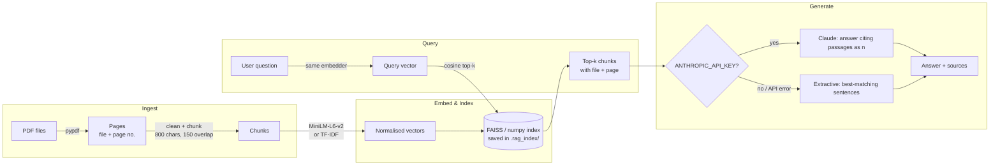

# RAG PDF Chatbot

Ask questions about your PDFs and get answers that cite the exact file and page they came from.

A retrieval-augmented generation (RAG) pipeline built from small, readable parts: PDF parsing, overlapping chunking, embeddings, a local vector index, top-k retrieval and answer generation with Claude. It ships with a Streamlit chat UI and a CLI, and it still works with no API key: it then answers extractively by quoting the best-matching sentences.

## Features

- **PDF ingestion** with `pypdf`, from file paths or browser uploads. Whitespace and hyphenation are cleaned up.
- **Page-aware chunking** on word boundaries with configurable size and overlap. Chunks never cross a page boundary, so every citation is a precise `file, p. N`.
- **Pluggable embeddings**: `sentence-transformers/all-MiniLM-L6-v2` when it is installed, otherwise a built-in TF-IDF embedder written in numpy.
- **Local vector index**: FAISS (`IndexFlatIP`) when installed, otherwise an exact numpy cosine-similarity index. Indexes are saved to disk and reloaded.
- **Grounded generation** with Claude (`claude-sonnet-5-5`) through the official Anthropic Python SDK. The prompt numbers the retrieved passages and Claude cites them as `[n]`.
- **Always answers**: if there is no `ANTHROPIC_API_KEY`, or the API call fails or is refused, the bot returns the most relevant sentences with their citations instead.
- **Two interfaces**: a Streamlit chat app (upload PDFs, chat, inspect sources and scores) and a `ragbot` CLI (`ingest`, `ask`, `chat`, `info`).
- **Tested**: 33 pytest tests cover chunking, retrieval ranking, citation formatting and the no-key fallback. They run offline.

## Tech stack

| Layer | Choice | Fallback |
|---|---|---|
| Language | Python 3.10+ (developed on 3.14) | |
| PDF parsing | pypdf | |
| Embeddings | sentence-transformers `all-MiniLM-L6-v2` | TF-IDF (numpy, sublinear tf, smoothed idf) |
| Vector index | FAISS `IndexFlatIP` | numpy exact cosine search |
| Generation | Anthropic Python SDK, `claude-sonnet-5-5` | extractive sentence selection |
| UI | Streamlit chat | `ragbot` CLI (argparse) |
| Tests | pytest | |

## Architecture



Code map: `ingest.py` (parse and chunk), `embeddings.py`, `vector_store.py`, `retriever.py` (store, search, persistence), `generator.py` (prompting, citations, fallback), `pipeline.py` (glue used by `cli.py` and `app.py`).

## Setup

```bash
git clone https://github.com/Simantini06/rag-pdf-chatbot.git
cd rag-pdf-chatbot
python -m venv .venv
# Windows: .venv\Scripts\activate    macOS/Linux: source .venv/bin/activate
pip install -r requirements.txt
pip install -e .                      # installs the `ragbot` command

# Optional extras (the app works without them):
pip install faiss-cpu                 # FAISS index
pip install sentence-transformers     # dense embeddings (pulls in PyTorch)
```

## Configuration

Copy `.env.example` to `.env` (it is git-ignored) and set what you need. Every setting is optional.

| Variable | Default | Purpose |
|---|---|---|
| `ANTHROPIC_API_KEY` | *(unset)* | Enables Claude answers. Without it you get extractive answers. |
| `RAG_MODEL` | `claude-sonnet-5-5` | Claude model used for generation |
| `RAG_EMBEDDER` | `auto` | `auto` (MiniLM if installed, else TF-IDF), `sentence-transformers` or `tfidf` |
| `RAG_CHUNK_SIZE` | `800` | Maximum characters per chunk |
| `RAG_CHUNK_OVERLAP` | `150` | Characters shared by neighbouring chunks |
| `RAG_TOP_K` | `4` | Chunks retrieved per question |
| `RAG_INDEX_DIR` | `.rag_index` | Where the index is saved (git-ignored) |

## Usage

### CLI

```bash
ragbot ingest data/sample_weather_station_guide.pdf   # also accepts globs: ragbot ingest "docs/*.pdf"
ragbot info
ragbot ask "What does the warranty not cover?"
ragbot ask "How long do the sensor batteries last?" -k 3 --scores
ragbot chat                                           # interactive, keeps the last few turns as context
```

`python -m rag_chatbot ...` works too.

### Streamlit

```bash
streamlit run app.py
```

Upload PDFs in the sidebar, click **Index uploaded PDFs**, then chat. Each answer has a **Sources** expander that shows the cited chunks, their file and page, and their similarity scores. A slider sets top-k.

## Example Q&A (real run)

This is the unedited output of the CLI in **fallback mode** (no `ANTHROPIC_API_KEY`, TF-IDF embeddings because `sentence-transformers` was not installed, FAISS index) on the bundled sample PDF. That PDF is a short, fictional product manual written for this repo, and `scripts/make_sample_pdf.py` regenerates it.

```text
$ ragbot ingest data/sample_weather_station_guide.pdf
Indexed data/sample_weather_station_guide.pdf: 6 chunks
Index saved to .rag_index (6 chunks, embedder=tfidf, index=faiss)

$ ragbot info
Index dir : .rag_index
Documents : sample_weather_station_guide.pdf
Chunks    : 6
Embedder  : tfidf
Index     : faiss
Generator : extractive (no ANTHROPIC_API_KEY)

$ ragbot ask "How long do the sensor batteries last?" --scores
(ANTHROPIC_API_KEY not set - showing extractive answer.)

Most relevant passages from your documents:
- Setup and Pairing Step 1: insert the two AA lithium batteries into the sensor mast. [2]
- Battery life. With lithium cells the sensor mast runs for about 18 months. [2]
- The sensor mast runs on two AA lithium batteries, which are not included. [3]

Sources:
  [1] sample_weather_station_guide.pdf, p. 2  (score 0.293)
  [2] sample_weather_station_guide.pdf, p. 2  (score 0.170)
  [3] sample_weather_station_guide.pdf, p. 1  (score 0.101)
  [4] sample_weather_station_guide.pdf, p. 3  (score 0.081)

$ ragbot ask "What does the warranty not cover?"
(ANTHROPIC_API_KEY not set - showing extractive answer.)

Most relevant passages from your documents:
- The warranty does not cover damage from lightning, physical impact or opening the sealed sensor housing. [1]
- Warranty. The Orbit-7 comes with a two-year limited warranty covering manufacturing defects. [1]
- To make a claim, keep your proof of purchase and quote the serial number printed under the battery cover. [1]

Sources:
  [1] sample_weather_station_guide.pdf, p. 3
  [2] sample_weather_station_guide.pdf, p. 3
  [3] sample_weather_station_guide.pdf, p. 2
  [4] sample_weather_station_guide.pdf, p. 2

$ ragbot ask "How often should I clean the rain gauge?" -k 3
(ANTHROPIC_API_KEY not set - showing extractive answer.)

Most relevant passages from your documents:
- Rain gauge reading too low: the funnel is probably blocked by leaves or dust. [1]
- Clean the funnel and the tipping bucket with water every three months. [1]

Sources:
  [1] sample_weather_station_guide.pdf, p. 3
  [2] sample_weather_station_guide.pdf, p. 2
  [3] sample_weather_station_guide.pdf, p. 1
```

Retrieval found the right page each time. The battery example shows where extractive mode falls short: it ranks sentences by word overlap, so a sentence about *inserting* batteries ranks above the one with the actual answer (18 months). Closing that gap is the job of the LLM step. With a key set, Claude reads the same retrieved passages and writes a single cited answer. I have not included a Claude-mode transcript because no API key was available when this README was written.

## Design decisions

- **Chunk size 800 characters, overlap 150.** 800 characters is about 150–200 tokens. That fits inside MiniLM-L6-v2's 256-word-piece input limit, so no chunk is silently truncated before it is embedded. It is also big enough to hold a full paragraph of context. An overlap of 150 characters (about one sentence) means a fact that falls on a chunk boundary still appears whole in at least one chunk. Chunks split on word boundaries and never cross a page, which is what makes the page citations exact.
- **top-k = 4.** Four chunks give Claude about 3,200 characters of context: enough to combine facts from different sections, but small enough to keep the prompt cheap and to avoid diluting the context with weakly related passages. On the sample PDF, the right page was ranked first for every question shown above. You can change top-k with `RAG_TOP_K`, `-k` or the Streamlit slider.
- **Numbered context and `[n]` citations.** The model only sees numbers, and the code maps each number back to `(file, page)`. A model cannot invent a citation that the UI will then display.
- **Graceful degradation.** Heavy dependencies (PyTorch via sentence-transformers, FAISS) are optional, and each has a pure-numpy fallback that uses the same interface. Generation falls back to extraction when there is no key, when the API returns an error, or when the request is refused. The CLI and UI therefore always run.
- **Re-ingesting replaces a file's chunks.** Uploading the same PDF twice does not create duplicates. The TF-IDF embedder is refitted on the whole corpus whenever documents change, because its vocabulary depends on the corpus. Dense embeddings only embed the new chunks.
- **Claude request settings.** The request uses low `effort` (short, grounded Q&A doesn't need deep reasoning) and the API's server-side refusal fallback (`fallbacks="default"`). It does not use `temperature`, because current models reject sampling parameters.

## Project structure

```text
rag-pdf-chatbot/
├── app.py                         # Streamlit chat UI
├── src/rag_chatbot/
│   ├── config.py                  # env-driven settings
│   ├── ingest.py                  # PDF parsing + overlapping chunking
│   ├── embeddings.py              # MiniLM / TF-IDF embedders
│   ├── vector_store.py            # FAISS / numpy cosine index
│   ├── retriever.py               # store, top-k search, persistence
│   ├── generator.py               # Claude generation, citations, extractive fallback
│   ├── pipeline.py                # RAGChatbot facade
│   └── cli.py                     # `ragbot` command
├── tests/                         # pytest: chunking, retrieval, citations, fallback
├── data/sample_weather_station_guide.pdf
├── scripts/make_sample_pdf.py     # regenerates the sample PDF (reportlab)
├── requirements.txt / requirements-optional.txt / pyproject.toml
├── .env.example
└── LICENSE
```

Run the tests with `pytest`. They make no network calls.

## Future work

- Hybrid retrieval (BM25 + dense) with reciprocal-rank fusion, plus a cross-encoder re-ranker.
- Streaming responses in the Streamlit UI.
- A small retrieval evaluation set (question → expected page) to report recall@k for different chunk sizes and embedders.
- OCR for scanned PDFs, and table-aware chunking.
- Highlighting the cited span inside a rendered PDF page.
- Swapping the flat index for Chroma or an HNSW index for large corpora.

## License

[MIT](LICENSE) © 2026 Simantini Das
